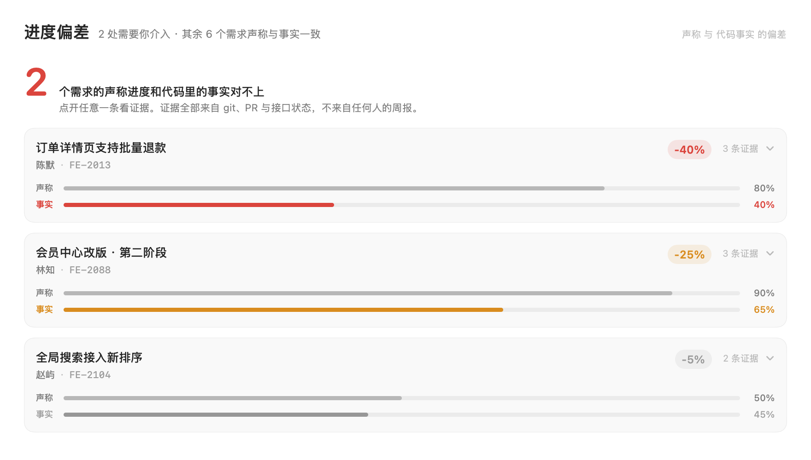

# team-work

团队工具集。第一个工具是 **TL Desk**：给前端 TL 用的只读观察台。

## TL Desk

一个 macOS 原生应用（SwiftUI，macOS 26 / Liquid Glass），把 TL 每天要问的四件事挪到一屏里：

| 面板 | 回答的问题 | 数据来源 |
|---|---|---|
| 进展 | 按时间该做完的，代码里还差多少 | issue 时间轴 vs 任务清单 / MR 状态 |
| 待 CR | 这个改动会炸到哪里 | 本地仓库的导入图 + 路由表反推 |
| Bug | 哪些被晾着、最久多久没人认领 | GitLab bug issue（可选：本地错误日志） |
| 健康度 | 哪条曲线比上一版变坏了 | 离线体检五项，棘轮比对 |



## 三条设计约定

1. **只读。** 所有输入都来自 git / GitLab / 本地体检，不要求任何人改变工作习惯，不做填报。
2. **颜色要分级。** 小偏差用灰色，只让真正需要介入的条目变红。一律刷红会让红色失信。
3. **不确定就明说。** 没算过的写「影响面待分析」，没数据的那栏就空着。**宁可空，也不填假数**。

## 结构

```
TLDesk/                 应用本体（只读消费快照）
├── Package.swift       SPM 可执行 target，平台钉 macOS 26
├── Info.plist          bundle 元数据
├── build.sh            编译 → 组 bundle → ad-hoc 签名
├── Sources/TLDesk/     视图、模型、玻璃材质、图表
├── fixtures/           sidecar 的 JSON 契约样例
└── renders/            离屏渲染产物（git 忽略）

sidecar/                采集与分析（Node，零依赖）
├── tl.mjs              CLI：scan / auth / projects / facts / health / impact
├── lib/scan.mjs        本机扫描：仓库发现、实例判定、凭据来源枚举
├── lib/auth.mjs        凭据解析（env → config → glab → 钥匙串 → netrc）
├── lib/gitlab.mjs      极简 REST 客户端，只有 GET
├── lib/facts.mjs       进展偏差 + 快照组装
├── lib/impact.mjs      导入图、路由识别、影响面反推
├── lib/health.mjs      离线体检 + 棘轮基线
├── lib/bugs.mjs        bug issue 归因
└── test/               64 个单测（node --test）
```

两层之间只有一个契约文件：

```
~/.tldesk/snapshot.json   ← sidecar 采集写入（四个面板）
~/.tldesk/scan.json       ← 本机扫描结果（扫描页，不含 token）
~/.tldesk/health.json     ← 体检基线（棘轮）
          ↓
      TLDesk.app          ← 只读消费，不联网、不写库、不常驻
```

静态分析留在 Node 生态（导入图、路由解析），Swift 端只负责展示。
这样既拿到原生材质与动效，又不用把分析逻辑重写一遍。

## 采集端

```bash
cd sidecar
node tl.mjs scan                                   # 先扫一遍：有哪些 GitLab 仓库、token 在哪
node tl.mjs auth                                   # 检查凭据、验证 token
node tl.mjs projects                               # 列出可见项目
node tl.mjs facts --project group/repo --repo ~/code/your-frontend
node tl.mjs health --repo ~/code/your-frontend     # 只跑体检，不需要 GitLab
node tl.mjs impact --repo . --files src/ui/Button.tsx
```

凭据按优先级自动解析，**不需要把 token 写进代码**：
`GITLAB_TOKEN` 环境变量 → `~/.tldesk/config.json` → glab CLI 配置 → 钥匙串（git credential）→ `~/.netrc`。
只需要 `read_api`，全程只有 GET，token 只在内存里。

### 本机扫描：让工具自己去找，别让人写配置

第一次用最烦的一步是「把你的 token 填进某个 JSON」。可凭据本来就在机器里，
所以 `tl scan` 自己去翻：

1. **找仓库**：从常见代码目录（或 `--roots` 指定）往下走，遇到 `.git` 就当作仓库根，
   不钻进 `node_modules`；`.git` 是文件时按 worktree 解析 `gitdir`
2. **判断是不是 GitLab**：五个本地信号任一命中即可 —— 域名含 gitlab、有 `.gitlab-ci.yml`、
   有 `.gitlab/` 目录、本机有该 host 的凭据、**该实例存在三级以上 group 路径**
   （GitHub 只有 `owner/repo`）。证据不足的 host 再问一次 `/api/v4/version`：
   401/403 也算命中（端点存在，只是要授权），连不上就记「无法确认」而不是「不是」
3. **找 token**：环境变量 / `~/.tldesk/config.json` / glab 配置 / `~/.netrc` /
   `~/.git-credentials` / shell 启动文件 / 项目里的 `.env`
4. **顺手报警**：remote URL 里内嵌了 token 是安全隐患，扫到就列出来

```bash
node tl.mjs scan                     # 人看：每个仓库都带「判定依据」
node tl.mjs scan --roots ~/code      # 代码不在默认目录时
node tl.mjs scan --keychain          # 额外读钥匙串（会弹系统授权框，默认不读）
node tl.mjs scan --write             # 把选中的 host/token/项目写进 config（600，原文件自动备份）
node tl.mjs scan --json              # 给 GUI / 脚本，始终脱敏
```

几个刻意的选择：

- **钥匙串默认不读。** 那会弹系统授权框并挂住进程，必须由人显式触发
- **同一个 token 出现在多处只显示一次**，但把所有出处都列出来
- **每个判定都给依据**，让人能自己判断这条可信不可信，而不是给一个没有来路的结论
- **GUI 不重新实现扫描**，它调同一条 CLI。两套实现一定会分叉，分叉之后
  「界面说没 token、命令行说有」会直接毁掉可信度

### 进展：计划 vs 事实

GitLab 里没有「声称进度」这种字段。硬造一个就得让人填表，那就违反了只读原则。
所以比的是两个都客观的量：

| | 怎么算 |
|---|---|
| **计划** | 时间轴应然进度：里程碑起止或到期日，线性推进 |
| **事实** | issue 任务清单勾选率；没有清单时退化为关联 MR 的状态 |

三条规矩：**没有时间基线的不做判断**（不猜）、**只报落后不报超前**（超前不需要干预）、
**差小于 5 个百分点视为噪声**（阈值只在 sidecar 里定义一次，UI 不再二次过滤）。

### 待 CR：影响面怎么算出来的

不是问人，也不是猜。对本地仓库做一次静态索引：

1. 解析 `tsconfig.json` 的 `paths` 别名（`@/*`），扫出全部源码文件
2. 抽取静态 `import` / `require` / `@import`，建**反向导入图**（谁引用了我）
3. 按 Next.js 约定识别路由：`app/**/page.tsx`、`pages/**/*.tsx`
4. MR 的改动路径从 GitLab `diffs` 接口取（只取路径，不取 diff 正文）
5. 从每个改动文件沿反向图往上爬，爬到路由文件就记一条受影响路由

风险分 = 路由数×2 + 共享改动数×3 + 改动文件数×0.5 + 碰到构建配置再加 5。

**边界写在代码里，也写在 UI 上**：只认静态引用（拼接的动态路径认不出）、
只认本地存在的文件（分支不一致的会进 notes 而不是硬算）、只认 Next 的路由约定。
识别不到路由时如实显示「没有路由引用这些改动」，不编。

### Bug：只有天数和归属是真的

没接监控 SDK，就没有「出现 14 次」这种数字。所以：

- **数字** = 这条 issue 已经开了多少天，标签是「天未认领 / 天未修」
- **归因** = 从描述里认出仓库内真实存在的文件路径，再用 `git log` 查最近一次改动它的 commit

措辞上严格区分「最近改动过」和「就是它引入的」——后者没有 sourcemap 和发布记录是断不了的。
如果往 `~/.tldesk/errors.jsonl` 写一行一条的错误记录（`{fingerprint,message,count,file}`），
数字才会变成真正的出现次数。

### 健康度：五项离线指标 + 棘轮

全部能在本地复算，一条网络请求都不发：

| 指标 | 怎么量 |
|---|---|
| 产物体积 | `dist/` `.next/` `build/` 的实际字节数，对预算 |
| 源码体量 | 产品代码行数 + 最大文件（测试与 fixture 不算） |
| 未使用的直接依赖 | `package.json` 对账导入图，工具链包与 `@types/*` 排除 |
| 重复版本依赖 | 读 `package-lock.json`，同名包锁了多个版本 |
| 废弃 API 面 | 固定模式表扫源码，命中项带文件名 |

基线存 `~/.tldesk/health.json`，留最近 12 次读数给 sparkline。
**所有指标都是「越小越好」，变坏 = 比上次大**，第一次跑只记基线不谎报变坏。

## 构建

```bash
cd TLDesk
./build.sh
open TLDesk.app
```

需要 **macOS 26** 与 Xcode 命令行工具（`glassEffect` / `GlassEffectContainer` /
`scrollEdgeEffectStyle` 是主要视觉语言，平台直接钉 26.0，不做旧系统降级）。

在受限沙箱里（CI 容器、agent 环境）SwiftPM 会二次套 `sandbox-exec` 而失败，
此时用 `SWIFT_FLAGS=--disable-sandbox ./build.sh`；本地终端不需要。

## 离屏出图

不依赖屏幕录制权限，直接把各面板渲染成 PNG：

```bash
./TLDesk.app/Contents/MacOS/TLDesk --render ./renders --appearance dark
```

用途是 UI 回归——改完样式跑一遍，用图对比，而不是靠肉眼点。

> 两个坑，都踩过：
> 1. `ImageRenderer` **不会实体化 `ScrollView` 的内容**，滚动容器必须留一条直排分支
>    （见 `PanelScaffold` 的 `offlineRender` 环境值），否则出图只有标题栏。
> 2. 它**画不出 Liquid Glass**——玻璃由窗口服务器合成。所以出图时玻璃会退化成替身薄片，
>    出图只用来看排版与层级，**观感必须以真窗口为准**。
> 3. 深色出图光设 `NSApp.appearance` 不够，动态色取的是 `currentDrawingAppearance`，
>    得用 `performAsCurrentDrawingAppearance` 包住渲染。
> 4. **`.buttonStyle(.glass)` 画出来是一块没有文字的实心方块** —— 玻璃按钮在出图里等于消失。
>    所以按钮走 `glassButton()` 包装，离屏时退成系统边框按钮（见 `Glass.swift`）。

## 现状

- [x] 四个面板的展示层 + Liquid Glass 材质 + 动效
- [x] 本机扫描：仓库发现 / 实例判定 / 凭据来源枚举，GUI 内可一键扫描并直接采集
- [x] sidecar 的 JSON 契约（Swift 端对旧快照做容错解码）
- [x] `tl facts` 采集（GitLab issue / MR），凭据自动解析
- [x] 影响面分析：反向导入图 + 路由反推 + 风险分
- [x] 本地健康度体检 + 棘轮基线 + sparkline
- [x] Bug：GitLab issue + 文件级 commit 归因
- [ ] sourcemap 反查 commit（需要构建产物与发布记录）
- [ ] CI 上报的历史趋势（现在是本地基线，不是团队共享）
